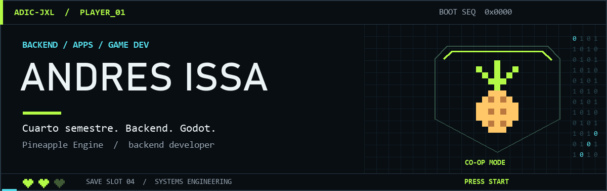
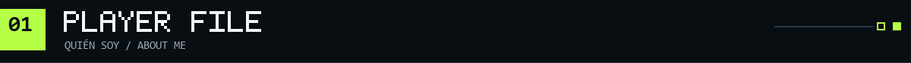
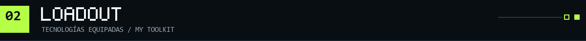
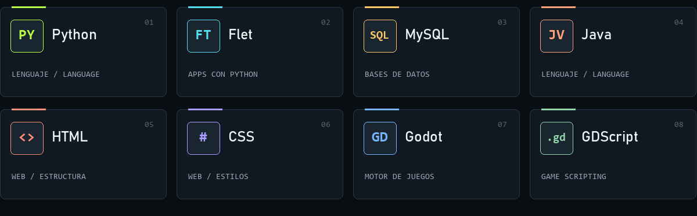
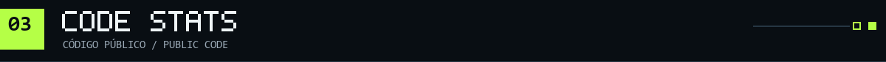
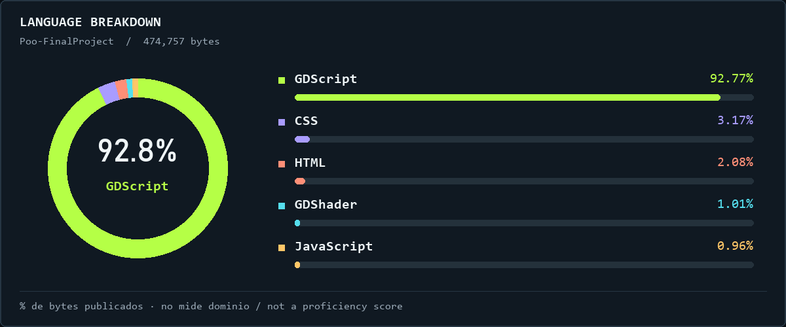
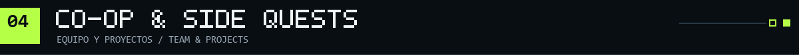
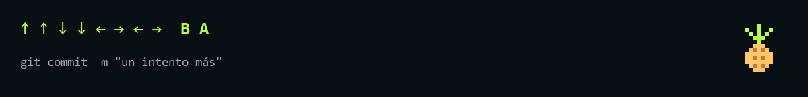

  

  <strong>Andres Issa</strong> · <code>adic-JXL</code> 
  Backend en Pineapple Engine · Ingeniería en Sistemas, 4.º semestre

  <a href="#player-file">Español</a> · <a href="#english">English</a> · <a href="https://github.com/adic-JXL?tab=repositories">Repositorios ↗</a>

## 

Soy **Andres Issa**. Estoy en cuarto semestre de **Ingeniería en Sistemas** y desarrollo páginas web y aplicaciones digitales.

Mi fuerte es **Python**, especialmente **Flet**. También trabajo con **MySQL, Java, HTML y CSS**. En **Pineapple Engine**, nuestro grupo de desarrollo de videojuegos, me encargo del **backend**. Y en mis proyectos personales hago juegos con **Godot**.

> Python + Flet para las apps. Godot para mis proyectos de videojuegos.

## 

## 

Datos de mi repositorio público Poo-FinalProject, consultados el 2 de noviembre de 2026. La gráfica representa código publicado, no mi nivel de dominio; mis proyectos con Python y Flet no están reflejados aquí.

## 

### 🍍 Pineapple Engine · modo cooperativo

Formo parte del equipo y me encargo de toda la parte backend de nuestros proyectos de videojuegos.

### 🎮 [Poo-FinalProject](https://github.com/adic-JXL/Poo-FinalProject) · proyecto con Godot

Código de uno de mis proyectos con **Godot y GDScript**. Puedes explorar el repositorio y ver lo que voy construyendo.

<strong>EN / English — open player file</strong>

### Hey, I'm Andres.

I'm in my **fourth semester of Systems Engineering**. I build websites and digital applications, with a strong focus on **Python and Flet**. I also work with **MySQL, Java, HTML, and CSS**.

I'm part of **Pineapple Engine**, a game development team, where I handle all **backend development**. For my personal projects, I make games with **Godot**.

**Equipped tools:** Python · Flet · MySQL · Java · HTML · CSS · Godot · GDScript.

**Public code:** The chart above shows the language distribution by bytes in my public Poo-FinalProject repository, as of November 2, 2026. It is not a proficiency score and does not reflect my Python/Flet work.

**Side quest:** [Poo-FinalProject →](https://github.com/adic-JXL/Poo-FinalProject)

 

